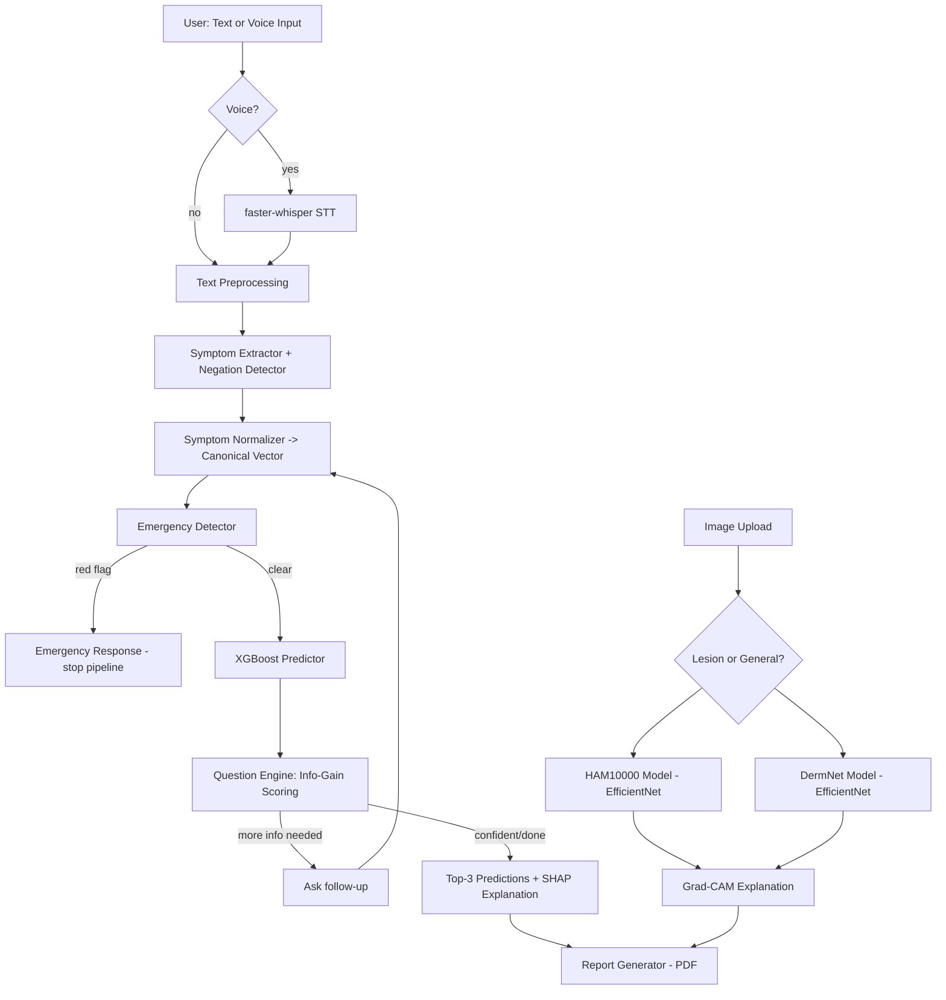

# AI Healthcare Assistant — Phase 1 Research & Architecture Proposal

Status: **Awaiting your approval.** No code has been written. Per your instructions, this document covers dataset research, ML-vs-DL reasoning, speech-to-text options, and the proposed architecture/folder structure only.

---

## 1. Symptom → Disease Prediction Datasets

Three real candidates, evaluated honestly (including their weaknesses — none of these are "clean" academic-grade clinical datasets, which is itself an important thing to be able to say in an interview).

### Candidate A — Diseases and Symptoms Dataset (dhivyeshrk)
- **Source**: Kaggle — `dhivyeshrk/diseases-and-symptoms-dataset`
- **License**: Kaggle-hosted, check dataset page for the specific open license (commonly CC/ODbL-style on Kaggle) — must be re-verified before redistribution.
- **Size**: ~246,000 samples
- **Classes**: 773 unique diseases
- **Features**: 377 one-hot encoded binary symptom columns
- **Target**: disease label (multi-class, 773-way)
- **Limitations**: extremely high class count relative to samples for many rare diseases → long-tail class imbalance; binary presence/absence loses severity, duration, and free-text nuance; likely synthetically generated or scraped from symptom-checker knowledge bases rather than real patient encounters (needs verification — this affects how honestly you can describe "real-world" performance in an interview).
- **Leakage risk**: Moderate — need to check for duplicate/near-duplicate rows across the 246k samples, since symptom-set combinations for the same disease are likely repeated with minor variation.
- **Verdict**: Good as a **structured baseline** for the tabular ML models (Logistic Regression / RF / XGBoost), but 773 classes is unrealistic for a resume-scale project — I'd recommend collapsing to the ~40–100 most clinically distinct/most frequent diseases.

### Candidate B — Disease Prediction Using Machine Learning (kaushil268)
- **Source**: Kaggle — `kaushil268/disease-prediction-using-machine-learning`
- **License**: Kaggle-hosted, verify specific terms on page.
- **Size**: Smaller, structured train/test split (thousands of rows)
- **Classes**: 42 diseases
- **Features**: 132 binary symptom columns
- **Target**: prognosis (42-way multi-class)
- **Limitations**: This is a widely reused "classic" Kaggle dataset — multiple public notebooks report ~100% test accuracy, which is a **major red flag**, not a success. Investigation shows the train/test split is close to a lookup table (each disease maps to a near-fixed symptom pattern), so accuracy is inflated by design, not generalization.
- **Leakage risk**: **High** — this is exactly the "100% accuracy without investigating leakage" trap your brief warns against. I would not present this as the primary dataset, but it's useful as a secondary sanity-check/smoke-test dataset because it's small and fast to iterate on.
- **Verdict**: Use for early pipeline testing only; document its leakage explicitly in `DATASETS.md` rather than hiding it.

### Candidate C — Symptom2Disease (niyarrbarman)
- **Source**: Kaggle — `niyarrbarman/symptom2disease`
- **License**: Kaggle-hosted, verify page terms.
- **Size**: ~1,200 rows
- **Classes**: 24 diseases
- **Features**: **free-text natural-language symptom descriptions** (e.g., "I have had a high fever and severe headache...") rather than pre-selected checkboxes
- **Target**: disease label (24-way)
- **Limitations**: small size for deep learning; only 24 conditions so coverage is narrow; text was likely written/paraphrased for the dataset rather than captured from real patients, so vocabulary diversity is lower than real clinical language.
- **Leakage risk**: Low-to-moderate — worth checking for near-duplicate paraphrases across rows for the same disease.
- **Verdict**: This is the **most important dataset for your project**, because it's the only one of the three that is actually natural-language text — which is what your text pipeline (symptom extraction → negation detection → normalization) needs to be trained/tested against. Candidate A is best for the structured prediction model; Candidate C is best for the NLP front-end.

### Recommended combination
- Use **Candidate A** (trimmed to top ~40–80 diseases by frequency) as the **structured prediction backbone** — this is what Logistic Regression/RF/XGBoost/MLP will train on, using canonical symptom vectors as input.
- Use **Candidate C** (Symptom2Disease) to **build and validate the NLP extraction layer** (mapping free text → canonical symptom vector), and optionally to fine-tune a lightweight text classifier as a second opinion/ensemble signal.
- Explicitly document in `DATASETS.md` that Candidate B is excluded from the final model due to leakage, with evidence.
- I did not find a strong PhysioNet/UCI/WHO dataset that fits *self-reported symptom → common-disease* prediction specifically — PhysioNet and UCI's medical sets skew toward specific conditions (heart disease, diabetes indicators from lab values) or ICU time-series, which is a different problem (that's more suited to the OCR/lab-report module in section 14 of your brief, not the primary symptom checker). I'd treat this as a legitimate scope boundary to state explicitly rather than force-fitting a mismatched dataset.

---

## 2. Skin Condition Image Classification Datasets

### Candidate A — HAM10000 ("Human Against Machine with 10000 images")
- **Source**: Harvard Dataverse / ISIC Archive; mirrored on Kaggle as `kmader/skin-cancer-mnist-ham10000`
- **License**: **CC BY-NC 4.0** (non-commercial, attribution required) — <cite index="20-1">data is provided under the CC BY-NC 4.0 license, with attribution made by referencing the original data descriptor manuscript (Tschandl, Rosendahl & Kittler)</cite>. This matters: a resume project is fine, but you cannot commercialize on this data without a different license.
- **Size**: <cite index="15-1,21-1">10,015 dermatoscopic images at 600×450 resolution</cite>
- **Classes (7)**: <cite index="16-1">melanocytic nevus, melanoma, basal cell carcinoma, actinic keratosis, benign keratosis, dermatofibroma, and vascular lesion</cite>
- **Class imbalance**: **Severe** — <cite index="17-1">nevi (NV) account for 6,705 of 10,015 images (~67%) while dermatofibroma has only 115 images (~1.1%)</cite>. This must be handled with class weighting, oversampling, or focal loss — do not report plain accuracy.
- **Metadata bonus**: <cite index="16-1">includes patient age, sex, and lesion anatomical site</cite>, which is useful for a richer model and for explainability discussion.
- **Limitations**: dermatoscope-captured images (magnified, controlled lighting) — not equivalent to a phone photo, which is what your users will actually upload. This is an important, honest caveat for the safety documentation.
- **Verdict**: **Primary dataset.** It's the de facto standard benchmark, well documented, and small enough to train on affordable compute.

### Candidate B — ISIC Archive / ISIC 2019
- **Source**: International Skin Imaging Collaboration, isic-archive.com
- **License**: Varies by contributing sub-collection, but the HAM10000 portion is CC BY-NC 4.0; the full archive is <cite index="13-1">over 485,000 public images</cite> as of late 2024 — much larger than HAM10000 alone.
- **Size/classes**: <cite index="14-1">ISIC-2019 aggregates 25,331 dermoscopic images</cite> across <cite index="19-1">8 categories including actinic keratosis, basal cell carcinoma, benign keratosis, dermatofibroma, melanoma, melanocytic nevus, squamous cell carcinoma, and vascular lesion</cite>.
- **Limitations**: still dermatoscopic (not phone-camera) images; still class-imbalanced (nevus-dominant); larger download/compute footprint.
- **Verdict**: Good **optional extension** if you want a larger, 8-class model or want to demonstrate transfer learning from HAM10000 → ISIC-2019, but not necessary for an MVP given compute/time constraints of a student project.

### Candidate C — DermNet (Kaggle, `shubhamgoel27/dermnet`)
- **Source**: Images sourced from the public DermNet NZ education portal, redistributed on Kaggle.
- **License**: Kaggle-hosted mirror of dermnet.com content — **must be verified carefully**; DermNet's own site now sells a separate, explicitly licensed "Dermatology image dataset" for commercial AI use, which is a strong signal that the free Kaggle mirror is intended for **educational/non-commercial use only**. Do not assume permissive commercial rights.
- **Size/classes**: <cite index="32-1">~19,500 images across 23 skin disease categories</cite>, typically split ~15,557/2,001/2,001 for train/val/test.
- **Limitations**: broader disease coverage than HAM10000 (not just pigmented lesions — includes infections, eczema, acne, etc., which matches your brief's "rash/acne/infection" use case better), but <cite index="32-1">baseline ResNet50 accuracy reported around only 0.64</cite>, reflecting real difficulty and image-quality/labeling noise — a good, honest baseline to beat and discuss rather than a dataset that hands you 99% accuracy.
- **Verdict**: **Best fit for your actual stated use case** ("skin rash/acne/pimple/infection") since HAM10000 is narrowly about pigmented/melanocytic lesions (cancer screening), while DermNet's 23 classes cover general dermatology. Recommend **DermNet as the primary training set for the general "skin condition" classifier**, and optionally use HAM10000 as a **separate, clearly-labeled "pigmented lesion / melanoma-risk screening" sub-model**, since mixing melanoma-screening and general-rash classification into one label space would be clinically misleading.

### Recommendation
Ship **two distinct, clearly-labeled image models** rather than one:
1. **General skin condition classifier** (DermNet, 23 classes, transfer learning) — for rashes/acne/common infections.
2. **Pigmented lesion screening classifier** (HAM10000, 7 classes) — explicitly scoped to moles/pigmented lesions, with extra-strong safety language given melanoma is a life-threatening class in the label set.
This keeps the model's claims honest instead of implying one general-purpose "skin AI" can safely evaluate everything from a mole to a burn.

---

## 3. Speech-to-Text Options

<cite index="28-1">Whisper is genuinely open — OpenAI released it under the MIT license for both code and weights, trained on 680,000 hours of multilingual, multitask audio</cite>, so licensing is not a concern here. The real decision is which **runtime** to deploy, not which model:

| Runtime | Best for | Notes |
|---|---|---|
| **faster-whisper** (CTranslate2) | NVIDIA GPU cloud deployment | <cite index="23-1">On an NVIDIA GPU, faster-whisper's CTranslate2 backend with int8 quantization is the speed and VRAM winner</cite>; <cite index="30-1">faster-whisper is roughly 4x faster than whisper.cpp on GPU with int8 quantization</cite>. |
| **whisper.cpp** | CPU-only / low-cost hosting, offline/local | <cite index="28-1">Best paired with Apple Silicon (Metal/MLX); a C/C++ port needing no Python or CUDA toolkit</cite>, so it runs cheaply on a small CPU-only cloud instance if you don't want GPU costs. |
| **OpenAI Whisper (reference PyTorch)** | Fastest to prototype with | <cite index="31-1">Easiest starting point with strong accuracy, but not the most efficient for production scale</cite>. |

**Recommendation**: Use **faster-whisper** with the `small` or `medium` model size for the backend voice pipeline. It's pip-installable, has a mature Python API that drops cleanly into a FastAPI service (`services/speech_service.py`), and gives a good accuracy/latency/cost balance without requiring a beefy GPU for a student-project deployment (Render/Railway free-to-cheap tiers). If deployment ends up CPU-only, whisper.cpp is the documented fallback — worth stating both in `docs/DEPLOYMENT.md` so you can explain the tradeoff in an interview.

---

## 4. ML vs. Deep Learning Recommendation

| Model | Fit for structured symptom data (Candidate A, ~40-80 classes, binary features) | Fit for free-text (Candidate C) |
|---|---|---|
| Logistic Regression | Strong baseline, fully interpretable, near-instant inference | Needs TF-IDF first; weak on nuance |
| Random Forest / **XGBoost** | Best expected accuracy/interpretability tradeoff on tabular binary features; handles class imbalance well with `scale_pos_weight`/class weights; native SHAP support | N/A directly |
| MLP | Marginal gain over XGBoost on this kind of data at real cost to interpretability | Possible but usually loses to transformer embeddings |
| BiLSTM/GRU | Not a good fit — no meaningful sequence structure in fixed binary symptom vectors | Reasonable but transformer embeddings generally outperform on short medical text at this data scale |
| **DistilBERT-style transformer** | N/A directly (not a text task) | Best fit for the ~1,200-row NLP dataset if fine-tuned carefully (or used as a frozen embedding source, since 1,200 rows is small for full fine-tuning) — but must be compared honestly against a TF-IDF + Logistic Regression baseline, which frequently wins at this dataset size |

**My recommendation, to be validated empirically in Phase 4–6, not assumed:**
- **Structured predictor**: **XGBoost** as primary candidate, benchmarked against Logistic Regression (interpretability baseline) and a small MLP (to prove/disprove whether deep learning helps). Given ~40-80 balanced-ish classes on binary features and no sequential structure, tree ensembles typically win — but this must be shown with actual F1/calibration numbers in `docs/MODEL_CARD.md`, not asserted.
- **NLP symptom extraction**: does **not** need a trained classifier at all for the *extraction* step — that's a job for a scispaCy/medical NER + negation-detection (e.g., NegEx-style rules) pipeline, which is more reliable and explainable than a black-box model for a 1,200-row dataset. Reserve DistilBERT fine-tuning for an optional secondary "does the free text match the structured prediction" cross-check model, and explicitly benchmark it against TF-IDF+LogReg — only keep it if it meaningfully wins.
- **Image classifiers**: **transfer learning (EfficientNet-B0 or ResNet50, ImageNet-pretrained)** is the correct choice, not a custom CNN from scratch — with only ~10-20k training images, a custom CNN will underfit or overfit while a pretrained backbone with a fine-tuned head is standard practice and gives you a legitimate "why transfer learning" answer for interviews. A custom CNN baseline should still be trained for comparison, per your brief.

---

## 5. Proposed High-Level Architecture



---

## 6. Proposed Folder Structure

Matches your Section 22 spec, with the two-image-model split reflected under `artifacts/` and `ml/vision/`:

```
AI-Healthcare-Assistant/
├── frontend/                 # React + Vite + TS + Tailwind
├── backend/                  # FastAPI (routes call inference/, never contain ML logic)
│   ├── api/routes/{assessment,voice,image,report}.py
│   ├── inference/{symptom_extractor,symptom_normalizer,negation_detector,
│   │              predictor,confidence,explainability,question_engine,
│   │              emergency_detector}.py
│   ├── models/{text_model,image_model,speech_model}/
│   ├── services/{speech_service,image_service,report_service,storage_service}.py
│   ├── schemas/{assessment,prediction,image,report}.py
│   └── config/settings.py
├── ml/
│   ├── text/{prepare_dataset,train_baseline,train_deep_learning,evaluate,inference_test}.py
│   ├── vision/{prepare_dataset,train_cnn,train_transfer_learning,evaluate,inference_test}.py
│   │   # run twice: --dataset ham10000 and --dataset dermnet
│   └── common/{metrics,reproducibility}.py
├── data/                      # raw/interim, gitignored
├── artifacts/
│   ├── text_model/{model,tokenizer,metadata.json}
│   ├── image_model_lesion/ (HAM10000)
│   ├── image_model_general/ (DermNet)
│   └── speech/metadata.json
├── notebooks/
├── tests/
├── docs/{ARCHITECTURE,DATASETS,MODEL_CARD,API,DEPLOYMENT,SAFETY}.md
├── docker/
├── .env.example / .gitignore / docker-compose.yml / README.md / LICENSE
```

---

## 7. What I need from you before Phase 2

1. **Approve or adjust the dataset choices**: Candidate A (trimmed) + Candidate C for text; DermNet + HAM10000 as two separate image models.
2. **Confirm the two-model split for images** (general skin condition vs. pigmented-lesion screening) rather than one merged model — I think this is the clinically honest choice but it's more work than a single model.
3. **Confirm faster-whisper** as the speech runtime (vs. whisper.cpp if you expect CPU-only, no-GPU hosting).
4. Anything from your original scope you want to trim for time (this is a large 22-phase plan) — e.g., is the OCR/lab-report module (Section 14) a must-have for v1, or a stretch goal after the core assessment + image modules work?

Once you confirm, I'll move to Phase 2 (repo scaffolding) and build incrementally, phase by phase, explaining each component as we go.
